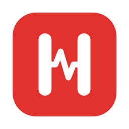

<p align="center"></p>

<h1 align="center">hogwatch</h1>

<p align="center">
  <a href="https://github.com/louiscada/hogwatch/actions/workflows/build.yml"></a>
  <a href="https://github.com/louiscada/hogwatch/releases/latest"></a>
  <a href="LICENSE"></a>
</p>

A tiny macOS menu bar app that stays out of the way until your Mac is struggling. When CPU or memory runs high, a small panel slides up from the bottom of the screen, names the apps responsible, and lets you quit them on the spot.

It answers "what is eating my Mac?" at the moment you need to know, without opening Activity Monitor.

## Features

**Knows when to speak up**

- Whole-Mac CPU staying above a level you choose
- Memory pressure, the same signal behind Activity Monitor's pressure graph, not just "percent used"
- A single runaway app holding a full processor core for a minute, even when the Mac as a whole is calm
- On battery, an app that keeps the processor busy and drains it

**Shows who is responsible**

- Helper processes are counted under their app: all of Chrome's helpers are "Google Chrome"
- Kernel and system services appear as one "macOS and system services" row, so apps are not blamed for load they did not cause
- Sort by CPU or memory, with usage shown as figures, a bar, or both
- A 60-second CPU graph in the panel header

**Lets you act safely**

- **Quit first, Force Quit second.** The button asks an app to quit normally and only becomes Force Quit if the app is still running
- Parts of macOS such as `loginwindow` and Control Center are shown with a lock and cannot be quit; Finder and the Dock get a Restart button
- Mute an app you expect to be busy and it never triggers an alert again

**Stays out of the way**

- Appears above the Dock without taking keyboard focus, and hides once things calm down
- Dismissing an alert snoozes alerts for a few minutes; the menu bar icon dims while they are paused
- Open or close the panel from any app with ⌃⌥H; Escape or a click elsewhere closes it
- Liquid Glass on macOS 26 Tahoe and macOS 27 Golden Gate, with a classic blurred look on macOS 13 to 15
- Native Swift, no dependencies, no administrator password

## Install

You need macOS 13 (Ventura) or later and Apple's developer tools. If you do not have them, run `xcode-select --install` first.

```sh
curl -fsSL https://raw.githubusercontent.com/louiscada/hogwatch/main/install.sh | bash
```

Or from a clone:

```sh
git clone https://github.com/louiscada/hogwatch.git
cd hogwatch
./install.sh
```

The installer builds hogwatch from source on your Mac, puts `hogwatch.app` in the Applications folder inside your home folder, links the `hogwatch` command into `~/.local/bin`, and sets it to open at login.

**Updating:** run the same command again. It replaces the installed copy and keeps your settings. When a newer release exists, hogwatch's menu shows "Version … Available…".

## Using it

The first time hogwatch runs it shows a short welcome. After that it lives in the menu bar as a small H icon.

### The panel

| Row | Button |
| --- | --- |
| Ordinary app | **Quit**, which lets the app save or ask first. If the app is still running afterwards, the button becomes **Force Quit**, which closes it immediately and loses unsaved changes |
| Finder, Dock | **Restart**. macOS relaunches them right away |
| Parts of macOS, and the system row | A lock. These are shown for information only |

When an alert is about one app, the footer offers **Mute This App**, and tells you if that app keeps coming up ("4th alert about it this week"). You can also right-click any row to mute or unmute it.

CPU figures are a share of the whole Mac, so the rows add up to the total in the header. Activity Monitor counts one core as 100%, so its numbers are higher; hover a row to see that figure too.

### When the panel appears

| Alert | Condition |
| --- | --- |
| CPU is running hot | Whole-Mac CPU above your threshold (85% by default) for about 6 seconds |
| Memory is under pressure | macOS reports memory pressure of warning or critical for about 4 seconds |
| An app has been working hard | One app using a full core or more for 60 seconds |
| An app is draining the battery | On battery, one app using half a core or more for 60 seconds |

Muted apps never trigger the two per-app alerts, and the CPU alert stays quiet while muted apps account for more than half of the load.

### The menu

| Item | What it does |
| --- | --- |
| Show Top Apps Now | Opens the panel on demand |
| Open Activity Monitor | Opens Activity Monitor |
| Pause Alerts for 1 Hour | Silences automatic alerts. While alerts are paused or snoozed it reads "Resume Alerts (Paused Until 7:20 PM)" |
| Settings… | Opens Settings |
| Version … Available… | Shown only when a newer release exists; opens its page on GitHub |
| About hogwatch | Version and credits |
| Quit hogwatch | Stops it until your next login |

### Settings

| Tab | Setting | Default |
| --- | --- | --- |
| General | Open at login | On |
| General | Check for updates | On |
| General | Menu bar shows the icon only, or the icon with CPU or memory | Icon only |
| Alerts | CPU level that counts as a busy Mac | 85% |
| Alerts | Memory pressure, runaway app and battery drain alerts | On |
| Alerts | Muted apps | None |
| Panel | Show usage as text, a bar, or both | Text |
| Panel | Position: left, centre or right | Centre |
| Panel | Keyboard shortcut: off, ⌃⌥H, ⌃⌥⌘H or ⌥⇧H | ⌃⌥H |
| Panel | Quiet time after dismissing an alert | 5 minutes |
| History | Alerts in the last 7 days, by app | |

### Command line

```sh
hogwatch --demo      # run and show the panel right away
hogwatch --version
hogwatch --help
```

## Privacy

hogwatch makes one kind of network request. If "Check for updates" is on, it asks GitHub's public API once a day for this repository's latest release. Nothing about you or your Mac is sent, and nothing is downloaded or installed. Turn the setting off and hogwatch never uses the network.

Settings, muted apps and alert history are stored on your Mac only. History entries older than 30 days are dropped.

Closing the panel by clicking elsewhere works by noticing that a click happened outside it. hogwatch cannot see what you clicked, and needs no Accessibility or Screen Recording permission.

## Footprint

hogwatch is built to cost very little while it waits:

- The whole-Mac reading runs every 2 seconds and is nearly free.
- The per-app measurement runs every 10 seconds while the Mac is calm, and every 2 seconds only while the panel is open or load is rising. It uses the kernel's lightest per-process report and skips processes it could not act on anyway.
- The panel and the Settings and welcome windows are created only when shown. The windows are released when closed.
- Nothing in the panel animates continuously.

On the Mac it was developed on (an Apple silicon MacBook Air with about 580 processes running), a 10-second profile at idle showed roughly 0.3% of one core. That is a single measurement, not a benchmark. The General tab in Settings shows what hogwatch is using on your Mac, averaged over the last few minutes.

## How it works

| Figure | Source |
| --- | --- |
| Whole-Mac CPU | `host_statistics` (`HOST_CPU_LOAD_INFO`) tick deltas |
| Memory used | `host_statistics64` (`HOST_VM_INFO64`): app memory, wired and compressed |
| Memory pressure | `kern.memorystatus_vm_pressure_level` |
| Per-app CPU and memory | `proc_pid_rusage` from libproc: CPU time deltas and physical footprint, summed per `.app` bundle |
| System row | CPU: whole-Mac load minus everything running under your account. Memory: wired (kernel) memory |
| Battery state | `IOPSGetProvidingPowerSourceType` |
| Keyboard shortcut | Carbon `RegisterEventHotKey` |

Limits worth knowing:

- Only processes running under your account are listed individually. They are the ones that can be quit without an administrator password.
- The "Memory" percentage in the header can differ from Activity Monitor's by a few points. Alerts do not depend on it; they follow memory pressure.
- The battery alert is based on sustained CPU use. Apple's "Energy Impact" formula is not public.
- Per-app GPU and network figures are not shown. macOS has no public API for either.
- One lookup has no public API: which app a system helper process belongs to. If a macOS release removes it, such helpers are listed on their own and everything else keeps working.

## Uninstall

From a clone:

```sh
./uninstall.sh
```

Or by hand:

```sh
launchctl bootout gui/$(id -u)/com.hogwatch.agent
rm ~/Library/LaunchAgents/com.hogwatch.agent.plist ~/.local/bin/hogwatch
rm -r ~/Applications/hogwatch.app
defaults delete com.louiscada.hogwatch
```

## Developing

```sh
swift build
swift run hogwatch --demo
```

`swift run` starts the bare program without the app bundle, so it shows a generic icon. `./install.sh` builds and installs the full app.

The icon lives in `Resources/`: `AppIcon.svg` is the editable source and `AppIcon.icns` is what the app uses.

| File | Role |
| --- | --- |
| `HogwatchApp.swift` | Entry point and command-line flags |
| `AppDelegate.swift` | Menu bar item, sampling timer, alert logic |
| `SystemSampler.swift` | Whole-Mac CPU, memory and memory pressure |
| `ProcessSampler.swift` | Per-process sampling and grouping by app |
| `PowerSource.swift` | Battery or charger |
| `PopupPanelController.swift` | The floating panel and its slide animation |
| `PopupModel.swift` | State shared with the panel |
| `PopupView.swift` | Panel contents |
| `Settings.swift` | User settings and tuning constants |
| `SettingsView.swift` | The four Settings tabs |
| `OnboardingView.swift` | First-run welcome |
| `WindowCoordinator.swift` | Creates and releases the Settings and welcome windows |
| `LoginItem.swift` | Open at login |
| `HotKey.swift` | Global keyboard shortcut |
| `AlertHistory.swift` | Log of past alerts |
| `UpdateChecker.swift` | Daily check for a newer release |

Every push is compiled on GitHub's macOS runners; the Build badge at the top shows the result. Issues and pull requests are welcome.

### Releasing a new version

1. Change the version in `Sources/hogwatch/Settings.swift` (`static let version`) and in `Resources/Info.plist` (`CFBundleShortVersionString`).
2. Commit and push.
3. On GitHub, open Releases, choose "Draft a new release", and set the tag to the same version with a `v` in front, for example `v0.1.1`. Publish it.

Installed copies compare that tag with their own version once a day and show "Version 0.1.1 Available…" in the menu.

## Author

Developed by [louiscada](https://github.com/louiscada). For questions, bugs or ideas, [open an issue](https://github.com/louiscada/hogwatch/issues). The same link is behind "Contact Developer" in Settings.

## License

MIT. See [LICENSE](LICENSE).
